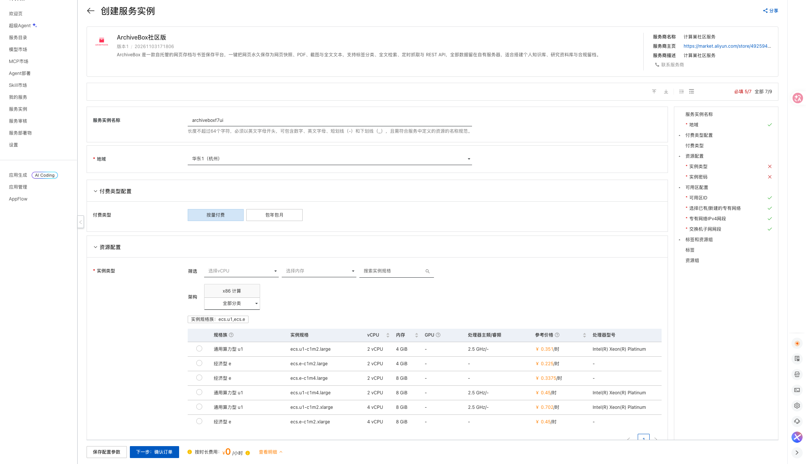
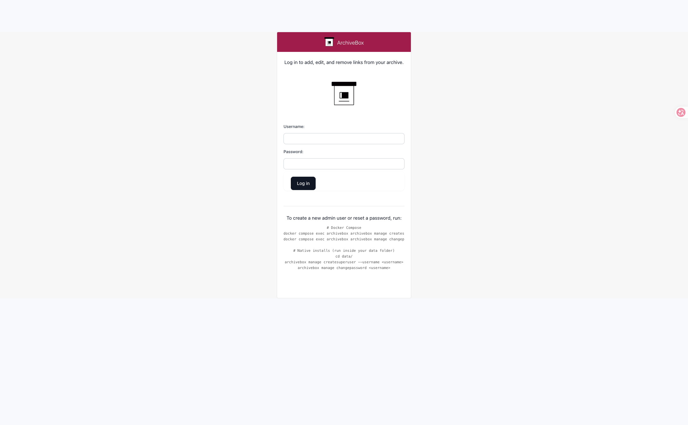

# ArchiveBox Community Edition on Compute Nest

## Overview

ArchiveBox is a self-hosted web archiving and bookmarking platform. Give it a URL and it permanently stores the HTML, PDF, screenshot and full text of the page, with full-text search, scheduled crawling and a REST API. This Compute Nest service deploys a single ECS instance with ArchiveBox and Docker Compose preinstalled. Everything is stored locally.

Authentication is enabled by default; the service is reachable at port 5797 of the instance public IP.

## Billing

The template is free. Deploying an instance incurs charges for:

- ECS instance
- 200 GiB ESSD system disk (fixed by the template)
- 5 Mbps public bandwidth (fixed by the template)

Pay-as-you-go and subscription are both supported.

## Required RAM permissions

| Policy | Purpose |
| --- | --- |
| AliyunECSFullAccess | Manage ECS resources |
| AliyunVPCFullAccess | Manage VPC resources |
| AliyunROSFullAccess | Manage ROS stacks |
| AliyunComputeNestUserFullAccess | Manage Compute Nest user resources |

## Deployment

1. Open the instance creation page, choose a region and instance type, and set the instance password.

   [Deploy link](https://computenest.console.aliyun.com/service/instance/create/cn-hangzhou?type=user&ServiceId=service-62cb9e66d49a4a308982)

   

2. Review the price and click **Create**.

3. After deployment, the **Outputs** section shows `archivebox_5797_url` and `AdminPassword`.

   

4. Open `http://<public-ip>:5797` and sign in as `admin` with the generated password.

   

## First use

Go to **Snapshots**, click **Add**, paste a URL and submit. ArchiveBox starts archiving the page immediately.

You can also use the CLI inside the instance:

```bash
docker exec archivebox archivebox add --depth=1 'https://example.com'
```

## Parameters

| Parameter | Description | Default |
| --- | --- | --- |
| VpcOption | NewVPC or ExistingVPC | NewVPC |
| VpcCidrBlock | CIDR of the new VPC | 192.168.0.0/16 |
| VSwitchCidrBlock | CIDR of the new vSwitch | 192.168.1.0/24 |
| EcsInstanceType | ECS instance type | none |
| InstancePassword | ECS login password | none |
| PayType | PostPaid or PrePaid | PostPaid |
| ZoneId | Availability zone | none |
| VpcId / VSwitchId | Existing VPC and vSwitch (ExistingVPC only) | empty |

## Outputs

| Output | Description |
| --- | --- |
| archivebox_5797_url | ArchiveBox URL |
| AdminUsername | Administrator user name (admin) |
| AdminPassword | Randomly generated administrator password |

## Security notes

- Anonymous index and anonymous snapshot access are disabled (`PUBLIC_INDEX=False`, `PERMISSIONS=private`, `PUBLIC_ADD_VIEW=False`).
- Submitting archives to external services such as archive.org is disabled.
- `SERVER_SECURITY_MODE=safe-onedomain-nojsreplay` suits plain public-IP access; full JavaScript replay is neutralised while static snapshots, PDFs, screenshots and full-text search keep working.
- Environment variables override `ArchiveBox.conf`. To change these settings, edit `/opt/archivebox/.env` on the instance and run `docker compose up -d`.
- `ADMIN_PASSWORD` only applies when the account is first created. Change it with `docker exec -it archivebox archivebox manage changepassword admin`.
- Archives are stored in `/opt/archivebox/data` on the system disk and are deleted with the instance.
