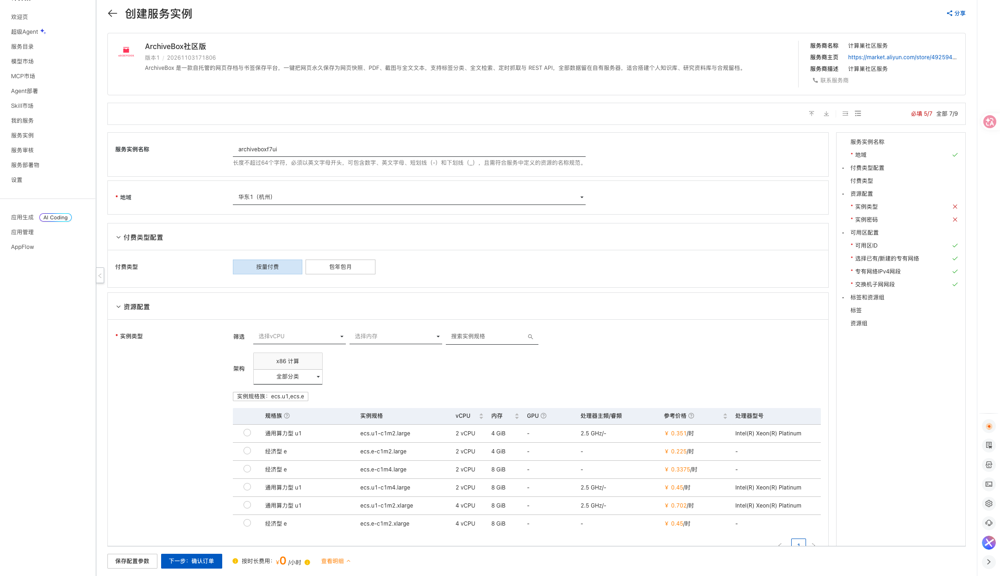
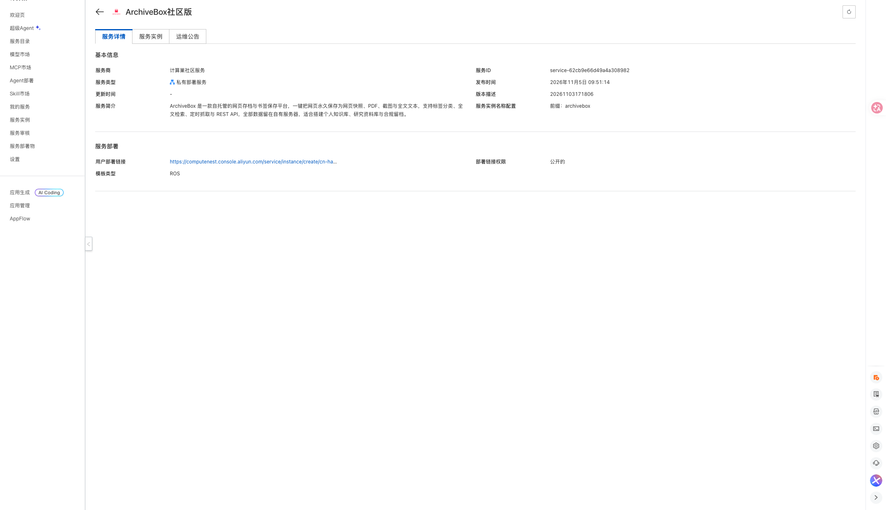
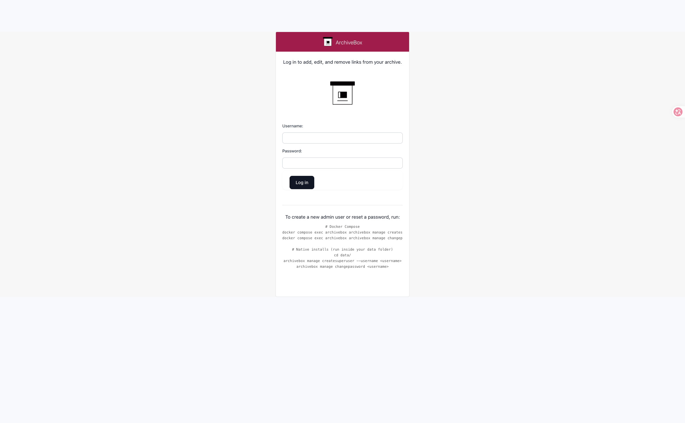

# ArchiveBox社区版计算巢部署文档

## 服务说明

ArchiveBox 是一款自托管的网页存档与书签保存平台：把网址丢进去，它会永久保存页面的 HTML、PDF、截图与全文文本，支持全文检索、定时抓取与 REST API。本计算巢服务采用单机 ECS 部署，ECS 镜像内已预置 ArchiveBox 与 Docker Compose 运行环境，存档数据全部保存在实例本机。

服务默认开启登录鉴权，访问入口为实例公网 IP 的 5797 端口。

## 计费说明

通过此服务模板构建服务不产生费用。用户部署服务实例时，资源费用主要涉及：

- ECS 实例规格
- 系统盘容量（模板固定 200 GiB ESSD）
- 公网带宽（模板固定 5 Mbps）

计费方式支持按量付费和包年包月，预估费用会在部署前实时展示。

## RAM账号所需权限

若使用 RAM 用户创建服务实例，需要在创建服务实例前为该 RAM 用户添加相应权限。

| 权限策略名称 | 备注 |
| --- | --- |
| AliyunECSFullAccess | 管理云服务器 ECS 的权限 |
| AliyunVPCFullAccess | 管理专有网络 VPC 的权限 |
| AliyunROSFullAccess | 管理资源编排 ROS 的权限 |
| AliyunComputeNestUserFullAccess | 管理计算巢服务用户侧资源的权限 |

## 服务实例部署流程

### 部署步骤

1. 打开计算巢服务实例创建页面，选择部署地域，填写实例规格、实例密码。网络可选择新建 VPC，也可以选择已有 VPC 与交换机。

   [部署链接](https://computenest.console.aliyun.com/service/instance/create/cn-hangzhou?type=user&ServiceId=service-62cb9e66d49a4a308982)

   

2. 确认询价明细后点击 **下一步：确认订单**，同意服务协议并点击 **立即创建**。

3. 等待服务实例部署完成。部署完成后，在服务实例详情页的 **输出** 区域查看 `archivebox_5797_url` 访问地址和 `AdminPassword` 管理员密码。服务详情页信息如下：

   

4. 用浏览器打开 `http://<实例公网IP>:5797`，使用用户名 `admin` 与输出中的管理员密码登录。

   

## 首次使用配置

### 1. 保存第一个网页

登录后进入 **Snapshots** 页面，点击 **Add**，粘贴目标网址并提交，ArchiveBox 会开始抓取并保存该页面。

### 2. 命令行保存

登录实例后可以通过容器内的 CLI 批量保存：

```bash
docker exec archivebox archivebox add --depth=1 'https://example.com'
docker exec archivebox archivebox help
```

## 参数说明

| 参数 | 说明 | 默认值 |
| --- | --- | --- |
| VpcOption | 网络类型，新建 VPC 或使用已有 VPC | NewVPC |
| VpcCidrBlock | 新建 VPC 的网段 | 192.168.0.0/16 |
| VSwitchCidrBlock | 新建交换机的网段 | 192.168.1.0/24 |
| EcsInstanceType | ECS 实例规格 | 无 |
| InstancePassword | 实例登录密码 | 无 |
| PayType | 付费类型 | PostPaid |
| ZoneId | 可用区 | 无 |
| VpcId / VSwitchId | 已有 VPC 与交换机 ID（选择已有 VPC 时填写） | 空 |

## 输出说明

| 输出 | 说明 |
| --- | --- |
| archivebox_5797_url | ArchiveBox 访问地址 |
| AdminUsername | 管理员用户名（admin） |
| AdminPassword | 系统随机生成的管理员密码 |

## 安全与使用说明

- 出厂关闭匿名索引页与匿名快照访问（`PUBLIC_INDEX=False`、`PERMISSIONS=private`、`PUBLIC_ADD_VIEW=False`），未登录只能看到登录页。
- 出厂关闭向 archive.org 等外部服务提交存档，所有抓取只在本机完成。
- 默认安全模式为 `safe-onedomain-nojsreplay`，适配纯公网 IP 单域访问，带 JavaScript 的全量交互回放会被中和；静态快照、PDF、截图与全文检索不受影响。
- 环境变量优先级高于数据目录下的 `ArchiveBox.conf`，上述安全项在管理后台里改不动。如需调整，请登录实例编辑 `/opt/archivebox/.env` 后执行 `docker compose up -d`。
- `ADMIN_PASSWORD` 只在首次初始化建号时生效；需要改密时执行：

  ```bash
  docker exec -it archivebox archivebox manage changepassword admin
  ```

- 管理员密码以环境变量方式注入容器，会出现在 `docker inspect` 输出与进程列表中；实例为单租户独占，仍建议登录后修改密码，并在公共网络下避免长时间保持会话。
- 存档数据保存在系统盘 `/opt/archivebox/data`（含 `index.sqlite3` 与快照文件），释放服务实例会一并删除。
